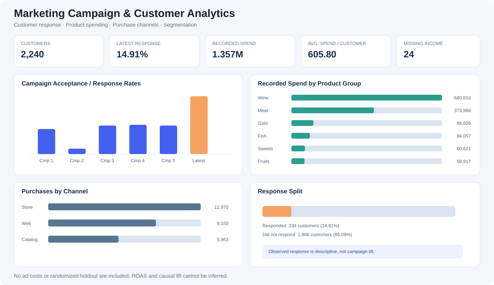

# Marketing Campaign & Customer Analytics

An end-to-end marketing analytics portfolio project using a public customer personality and campaign-response dataset. The project demonstrates data quality checks, SQL analysis, Python/Pandas workflows, customer segmentation, an interactive dashboard, and evidence-based marketing recommendations.

**Tools:** MySQL 8 · SQL · Python · Pandas · Plotly · GitHub

**[Open the interactive dashboard](https://htmlpreview.github.io/?https://raw.githubusercontent.com/Zaheermuhammadasad/marketing-campaign-analytics/main/dashboard/marketing_campaign_dashboard.html)** · **[Business insights](analysis/business_insights.md)** · **[Setup instructions](documentation/getting_started.md)** · **[CV/LinkedIn entry](documentation/cv_linkedin_project_entry.md)**



**[View dashboard source](dashboard/marketing_campaign_dashboard.html)** · **[View analysis code](python/marketing_campaign_analysis.py)**

## Business problem

A business wants to understand campaign response, customer purchasing behaviour, product affinity, and channel preference. This project turns customer-level records into actionable questions for the marketing team.

### Questions explored
- What proportion of customers responded to the latest campaign?
- How do historical campaign acceptance rates compare descriptively?
- Which product groups account for the most recorded spend?
- How do customers differ by recency, spending and channel behaviour?
- What data-quality issues should be resolved or flagged before targeting?
- What additional tracking would be needed to estimate incremental campaign lift or marketing ROI?

## Validated dataset overview

| Metric | Result |
|---|---:|
| Customer records | 2,240 |
| Source fields | 29 |
| Duplicate customer IDs | 0 |
| Missing income values | 24 |
| Latest campaign responders | 334 |
| Latest campaign response rate | 14.91% |
| Customers accepting one or more historical campaigns | 568 |
| Total recorded product spend across six product groups | 1,356,988 |
| Average product spend per customer | 605.80 |
| Median product spend per customer | 396 |
| Store purchase count | 12,970 |
| Web purchase count | 9,150 |
| Catalog purchase count | 5,963 |

Spend values are in the source dataset's monetary units. Campaign response is an observed outcome, not a causal lift measurement.

## Key findings

- **Latest campaign response:** 334 of 2,240 customers responded (14.91%).
- **Product affinity:** wine spending leads at 680,816, followed by meat products at 373,968.
- **Purchase channels:** store purchase counts (12,970) exceed web (9,150) and catalog (5,963).
- **Data quality:** 24 missing income values, three birth years at or before 1900, and an extreme income value of 666,666 should be reviewed.
- **Historical acceptance:** observed acceptance rates ranged from 1.34% for Campaign 2 to 7.46% for Campaign 4.

These are descriptive findings. They do not prove why a customer responded or whether one campaign caused higher spending.

## Interactive dashboard

The dashboard includes KPI cards and charts for campaign acceptance/response, product-group spending, purchase channels, and response split. It is browser-based HTML using Plotly, not a native Power BI PBIX or Tableau TWB file.

**[Launch the interactive dashboard](https://htmlpreview.github.io/?https://raw.githubusercontent.com/Zaheermuhammadasad/marketing-campaign-analytics/main/dashboard/marketing_campaign_dashboard.html)**

The HTML loads Plotly from a CDN, so an internet connection is required when viewing the charts.

## Repository structure

- `sql/` — data quality, customer spend/channels, campaign response, and segmentation queries.
- `python/marketing_campaign_analysis.py` — reusable Pandas workflow and summary generation.
- `python/requirements.txt` — dependencies.
- `dashboard/` — interactive dashboard source and static visual preview.
- `outputs/` — small summary tables and validated headline metrics, not raw customer records.
- `analysis/business_insights.md` — findings, recommendations and limitations.
- `documentation/data_dictionary.md` — field groups and metric definitions.
- `documentation/getting_started.md` — dataset setup and run commands.
- `documentation/cv_linkedin_project_entry.md` — portfolio wording.

## Run the analysis

1. Install Python 3.10 or later.
2. Download `marketing_campaign.csv` from the public [Customer Personality Analysis dataset source](https://github.com/johng034/customer-segmentation/blob/master/marketing_campaign.csv).
3. Save the CSV locally as `data/marketing_campaign.csv`. The row-level CSV is intentionally excluded from this repository; `.gitignore` protects the local copy.
4. Install dependencies and run:

```bash
python -m pip install -r python/requirements.txt
python python/marketing_campaign_analysis.py --input data/marketing_campaign.csv --output outputs
```

5. Open `dashboard/marketing_campaign_dashboard.html` in a browser.
6. To run SQL, import the CSV into MySQL 8 as table `marketing_campaign` and execute scripts in `sql/` order 01–04.

## Metric definitions and limitations

- `Response` is the latest campaign response flag; its mean is the observed response rate.
- `AcceptedCmp1`–`AcceptedCmp5` represent historical campaign acceptance flags.
- `total_spend` is the sum of six `Mnt*` product-group columns. It is not profit or margin.
- Purchase-channel fields are purchase counts per customer; they are not conversion rates or ad attribution.
- The dataset contains no reliable media-cost, impressions, clicks, randomized holdout, or contribution-margin data. **Do not infer ROAS, CAC, incremental lift, or causal campaign impact.**
- Income outlier and implausible birth-year records are flagged for review rather than silently removed.

## Skills demonstrated

Data cleaning · Data-quality checks · SQL joins and aggregation · Python/Pandas · KPI definition · Customer segmentation · Exploratory analysis · Interactive data visualization · Marketing interpretation · Reproducible documentation